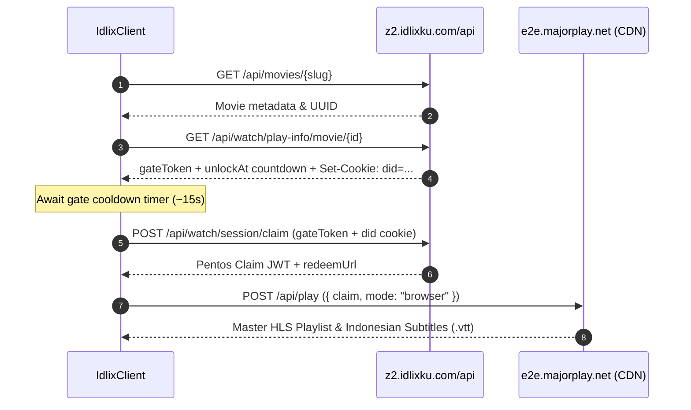

# 🎬 Idlix-Resolver

> High-performance stream and Indonesian subtitle extractor for **IDLIX** (`z2.idlixku.com`) powered by Pentos protocol automation and TLS browser impersonation.

[](https://opensource.org/licenses/MIT)
[](https://nodejs.org/)
[](https://www.typescriptlang.org/)

---

## 🌟 Features

- ⚡ **Full Pentos Protocol Support**: Automatically negotiates Gate Tokens, Countdown Gates, Session Claims, and Majorplay CDN redemption.
- 🛡️ **Bypass Cloudflare Challenges**: Powered by [`impit`](https://github.com/cloudflare/impit) with Chrome JA3/TLS fingerprinting.
- 🇮🇩 **Indonesian Subtitles Built-in**: Directly extracts synchronized `.vtt` subtitles in Bahasa Indonesia and other available languages.
- 📺 **HLS Master Playlist Extraction**: Resolves adaptive bitrate HLS streams (`.m3u8` / multi-quality 1080p/720p).
- 🔄 **Support for Movies & TV Series**: Resolves streams by TMDB ID, slug, or content UUID.
- 🛠️ **CLI & Programmatic API**: Use as a command-line utility or import as an npm package in your Node.js/TypeScript backend.

---

## 📦 Installation

```bash
npm install idlix-resolver
```

Or run directly with `npx`:

```bash
npx idlix-resolver search "Spider-Man"
```

---

## 📺 Interactive Terminal User Interface (TUI)

Launch the interactive Terminal UI to search, choose episodes, and **watch movies/series directly**:

```bash
# In the project directory:
npm start

# Or using npx:
npx idlix-tui
```

### 🎮 What the TUI Offers:
- 🔍 **Interactive Search**: Browse titles and select with keyboard arrow keys.
- 📺 **Series Season & Episode Selector**: Seamless navigation across TV shows.
- ⏳ **Gate Countdown Display**: Real-time spinner showing seconds until playback unlocks.
- 🚀 **One-Click Playback**: Directly launches:
  - **FFplay** (fast, lightweight, auto-detected)
  - **MPV** (with native subtitle track injection)
  - **VLC Media Player**
  - **Web Browser Player** (beautiful built-in HTML5 dark mode player with Hls.js)

---

## 🌐 HTTP REST API Server

You can run `idlix-resolver` as a standalone high-performance REST API microservice:

```bash
# Start the API server on default port (3000)
npm run api

# Or specify a custom port:
npx idlix-resolver api --port 8080
```

### 📡 API Endpoints

| Method | Endpoint | Description |
|---|---|---|
| `GET` | `/` | Interactive API documentation & live testing playground (HTML/JSON) |
| `GET` | `/health` | Health check & uptime status |
| `GET` | `/api/search?q={query}` | Search IDLIX catalog for movies & series |
| `GET` | `/api/movie/{slug}` | Get movie metadata and UUID |
| `GET` | `/api/series/{slug}` | Get TV series metadata, seasons, and episode lists |
| `GET` | `/api/resolve/movie/{slug}` | Resolve movie M3U8 stream & subtitles |
| `GET` | `/api/resolve/series/{slug}/{season}/{episode}` | Resolve series episode stream & subtitles |
| `GET` | `/api/resolve?type={movie\|series}&slug={slug}` | Unified resolver endpoint |
| `GET` | `/api/stream?url={targetUrl}` | **CORS-enabled HLS proxy** for web video players |
| `GET` | `/api/subtitle?url={vttUrl}` | **CORS-enabled subtitle proxy** for subtitles |
| `GET` | `/watch?type={movie\|series}&slug={slug}` | Built-in responsive HTML5 web player with Indonesian subtitles |

### 💡 Embedded API Server in your code

```typescript
import { createApiServer } from 'idlix-resolver';

const server = createApiServer({ port: 3000 });
await server.listen();
```

---

## 🚀 Quick Start (CLI & API)

### 1. Programmatic API (TypeScript / ESM)

```typescript
import { IdlixClient, search, resolveMovie, resolveEpisode } from 'idlix-resolver';

// 1. Search content
const searchResults = await search('Spider-Man');
console.log('Results:', searchResults.results);

// 2. Resolve a movie by slug or ID
const movieStream = await resolveMovie('sin-city-2005', {
  onCountdown: (secondsRemaining) => {
    console.log(`Gate countdown: ${secondsRemaining}s remaining...`);
  }
});

console.log('Stream Playlist URL:', movieStream.playlistUrl);
console.log('Indonesian Subtitle:', movieStream.subtitles.find(s => s.lang === 'id')?.path);

// 3. Resolve a TV series episode
const episodeStream = await resolveEpisode('visionquest-2026', 1, 1, {
  onCountdown: (sec) => console.log(`Unlocking episode: ${sec}s...`)
});
console.log('Episode Stream:', episodeStream.playlistUrl);
```

---

### 2. Command Line Interface (CLI)

```bash
# Search for movies or TV series
npx idlix-resolver search "Inception"

# Resolve a movie stream
npx idlix-resolver resolve "sin-city-2005"

# Resolve a specific TV series episode
npx idlix-resolver episode "visionquest-2026" 1 1
```

---

## 🧠 How It Works Under The Hood

IDLIX protects its video streams using an internal architecture called **Pentos Protocol**:



`idlix-resolver` handles this entire sequence automatically with robust cookie and session preservation.

---

## 📋 Data Types

```typescript
interface ResolvedStream {
  title: string;
  videoId: string;
  playlistUrl: string;
  masterM3u8Content?: string;
  expiresAt: number;
  ttlSeconds: number;
  subtitles: SubtitleTrack[];
  headers: Record<string, string>;
}

interface SubtitleTrack {
  lang: string;      // e.g. "id", "en"
  label: string;     // e.g. "Indonesian", "English"
  path: string;      // URL to .vtt file
  isDefault?: boolean;
}
```

---

## 📄 License

MIT © [Arief Muhammad Ammar](https://github.com/ariefmuhammadammar)
